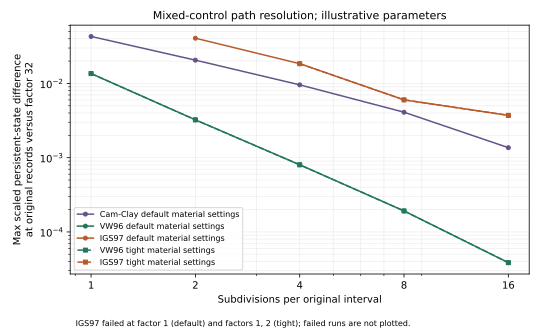

# Experimental recorded-path refinement

`atlas.cli refine-recorded` investigates caller-path resolution independently of the material integrator's internal tolerances. The [study schema](../schemas/recorded-refinement.schema.json) contains fully specified recorded-run requests, fixed case IDs and nested subdivision factors. It neither fits parameters nor converts an experimental curve into controls.

For each original interval, factor `n` inserts `n-1` knots with **linear interpolation of its coordinate and six absolute control targets**. Exact original endpoints, order, reversals and repeated targets are preserved, including a map back to every original observation. Initial strain, state, parameters, control rows and settings stay unchanged. There is no sorting, deduplication, extrapolation, physical-time interpolation or adaptive insertion. The refined path must satisfy the existing 5,001-knot and floating-point ordering checks before any execution.

This is an explicit change to the caller path: additional stress endpoints constrain the constitutive response more frequently. Between caller endpoints, material substeps still follow the solver's straight strain-increment direction. Changing caller knots can also alter parent-increment events. A refinement study does not establish a continuous-control limit or a source-specific integration prescription by itself.

## Execution and failures

```sh
python3 -m atlas.cli refine-recorded benchmarks/recorded-path-density.json \
  --solver build/atlas_solver --output density.json
python3 -m atlas.cli refine-recorded benchmarks/recorded-plastic-path-density.json \
  --solver build/atlas_solver --output plastic-density.json
```

The retained examples deliberately contain coarse failures: **each command exits with status 1 while retaining all its runs**. This is not a successful scientific-validation gate. Run the commands independently and inspect their reports. A clean reproduction builds the native solver first as described in the README; these commands only execute an existing binary and launch each level serially.

The study checks the executable's catalogue against the current generated definitions. Reports identify the parsed study hash, binary hash, catalogue identity, model-definition hashes, resolved parameters/initial states, complete requests and numerical settings. They checkpoint after every run. Constitutive failures retain their complete API response and accepted prefix. Process/transport exceptions retain a typed message and do not invent a state. Execution of other predeclared levels continues independently. `execution_complete` means the study reached its end; it does not mean every replay succeeded or any accuracy threshold passed.

Comparison uses only matching **original observations**, never a strain-sorted or density-weighted curve grid. A failed level has no full-path metric. The comparator is the **requested finest level**; if it fails, every finest-level metric remains absent. It is never replaced by a selected successful level. A failed intermediate level breaks successive-level comparisons. Initial conditions and parameters must agree across levels.

Field maxima retain physical units. Persistent-state differences are divided by each model field's declared positive parameter-based scale, then maximized over components, fields and original observations. Accumulated-strain component differences are reported separately. Increment-local `transient` fields, including plastic multipliers, remain in per-field reports and a separate transient norm, but are excluded from the persistent-state norm: changing the caller increment changes the meaning of a per-increment multiplier. These are numerical comparison scales, not experimental uncertainties or universal scientific error thresholds.

## Retained native investigation

The [evidence manifest](../catalogue/investigations/recorded-refinement-v1/manifest.json) retains **60 responses in two studies: 54 successful, six failed**. Factors are `1,2,4,8,16,32`, giving 6–161 records per path. The five public laws use illustrative defaults. The mixed-control path has axial targets `0, 0.003, -0.001, -0.001, 0.004, 0`, radial stresses held at 100 kPa at endpoints, and zero shear strains. VW96 and IGS97 are also run with rate tolerance `1e-8`, residual tolerance `1e-11` and depth 18; all other material and outer-control settings stay at defaults. An IGS97 nonproportional all-strain case exercises all three shears. A separate pair crosses plastic loading/unloading: larger drained strains for Drucker–Prager and prescribed isotropic strain for Cam-Clay.

| Case | Successful factors | Max stress-component change, factor 16 → 32 |
| --- | --- | ---: |
| Elastic drained | all | 0 Pa |
| Drucker–Prager, smaller drained path | all | 1.60e-10 Pa |
| Cam-Clay, smaller drained path | all | 136.37 Pa |
| VW96 drained, default / tight | all / all | 3.85 / 3.85 Pa |
| IGS97 drained, default / tight | 2–32 / 4–32 | 371.48 / 371.43 Pa |
| IGS97 nonproportional strain | all | 2.04e-10 Pa |
| Drucker–Prager plastic drained | 8–32 | 6.40e-10 Pa |
| Cam-Clay plastic isotropic strain | all | 4,434.94 Pa |

The smaller Drucker–Prager/Cam-Clay runs stay elastic in the retained observations; they are not evidence of plastic-regime coverage. The separate plastic study confirms nonzero plastic multipliers in both laws and Cam-Clay hardening. Drucker–Prager's successful fine paths nearly agree in persistent stress/state while their local multiplier changes with the increment length. Cam-Clay's plastic response remains visibly resolution-sensitive at the finest pair; no converged plastic reference is claimed.

The three IGS97 failures occur in the first material trial of the stress-control solve. The three Drucker–Prager plastic failures occur during unloading on coarse paths. These observations do not distinguish domain, integrator and root-initialization causes: the current engine failure message combines those possibilities. Successful refined paths do not prove a coarse path should succeed, nor that a model is physically invalid when it fails.

At factor 32, changing internal settings gives maximum scaled persistent-state differences of `9.13e-6` (VW96) and `1.28e-5` (IGS97). Corresponding factor-16-to-32 path differences are `3.85e-5` and `3.71e-3`. This separates two sensitivities in these cases; neither difference is an independent estimate of true error. Tightening material tolerances does not remove coarse IGS97 failures. The near-identical nonproportional all-strain results are specific to this path and its adaptive subdivisions, not a general invariance guarantee.



The figure omits the factor-32 comparator's identically zero self-difference and does not plot failed runs. Nearly coincident default/tight curves are intentional. Elastic/near-roundoff cases are in the table, not on the logarithmic figure. No ranking, experimental calibration, independent scientific review or constitutive admission follows from this investigation.

## Analysis and regression

```sh
python3 tools/analyze_recorded_refinement.py density.json --output summary.json \
  --pair hypoplastic-sand-vw96-drained-default=hypoplastic-sand-vw96-drained-tight \
  --pair hypoplastic-sand-igs97-drained-default=hypoplastic-sand-igs97-drained-tight \
  --figures figures
python3 tools/analyze_recorded_refinement.py plastic-density.json --output plastic-summary.json
python3 -m unittest tests.test_refinement -v
```

Only optional figure generation needs Matplotlib (retained version: 3.11.2). JSON analysis and tests use the standard library. The verifier checks the case/factor matrix, request hashes and wire, endpoint constraints, resolved settings, original-record mapping, failure prefixes and stored differences. Separate analytical elasticity checks cover every retained elastic observation. Mocked failure/timeout tests verify that failed finest/intermediate levels cannot silently disappear from metrics; offline corruption tests reject altered grids, settings and metrics. These checks supplement source review and experimental validation, which remain open.
