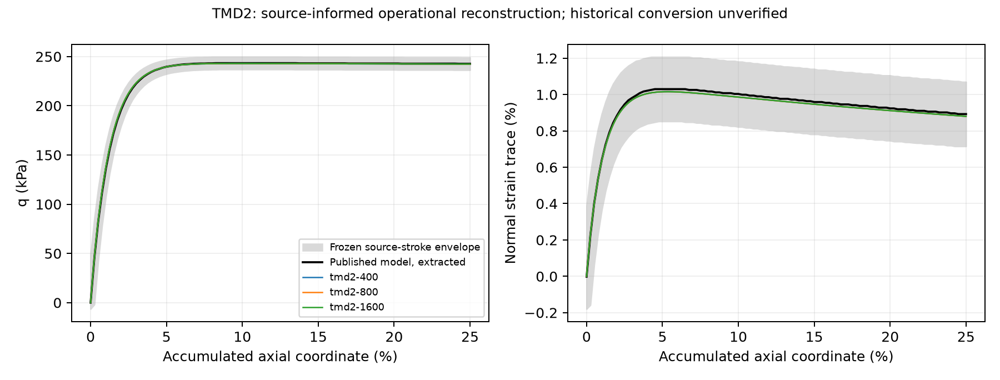

# TMD2 local reproduction

Source-informed operational reconstruction; historical strain conversion and independent scientific admission remain open.

Experimental errors are descriptive calibration-campaign errors, not held-out validation. Measured volume is fractional volume change; finite-kinematic equivalence is not verified.

| Path | Source envelope | q RMSE (kPa) | Volume RMSE (percentage points) |
| --- | --- | ---: | ---: |
| tmd2-400 | True | 23.536876447441553 | 0.20773807318344364 |
| tmd2-800 | True | 23.540641944840583 | 0.2077394953779085 |
| tmd2-1600 | True | 23.54165808860874 | 0.20773971395446944 |

| Adjacent paths | Max q change (Pa) | Max volume change | Pass |
| --- | ---: | ---: | --- |
| tmd2-400 → tmd2-800 | 16.939085606019944 | 6.870843898415524e-07 | True |
| tmd2-800 → tmd2-1600 | 5.613943905365886 | 5.743960984766483e-07 | True |

Sources: [2016 database](https://doi.org/10.1007/s11440-015-0402-z), [2019 model comparison](https://doi.org/10.1016/j.soildyn.2019.05.001).

See results/summary.json for every source gate and all error metrics. Raw/normalized measurements remain local research files; no public redistribution grant is inferred.
