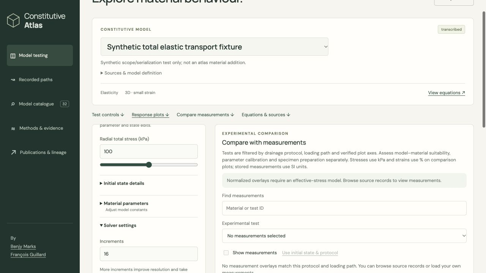

# Laboratory stress-scope browser integration

Bounded delivery: coherent laboratory scope consumers, with nine public models unchanged. Production total-stress validation remains disabled; the total elastic model is an isolated private fixture, not an admitted scientific model. No deployment, push, new native simulation, parameter fitting or source ingestion occurred.

The page and worker now use the strict scoped laboratory APIs, carry the exact compiled catalogue, derive scope and protocol labels from canonical metadata, preserve full-state examples and JSON exports, and write scope-specific CSV. Unavailable pore pressure has a reason and no model curve. Effective protocol 2 retains reconstructed pressure under the documented incompressible-fluid/grains and fixed-radial-total-stress assumptions. Existing effective-only experiment overlays and state matching remain guarded; total source browsing is available. Legacy effective imports replay and retain their old export version. Missing scoped APIs do not fall back.

## Prospective gate and outcomes

`freeze.json` predates observations. One explicit public nine-record Wasm target compiled successfully with `--parallel 1`; configure/build receipts, source hashes, CMake recipe and artifact hashes are retained. Nine zero-path responses match the existing native laboratory receipts at the frozen relative 1e-9 tolerance, with exact structure/counters. Elapsed time and the explicitly changed response metadata are excluded; historical unavailable numeric zero is compared as scoped null. This is a regression check, not nonzero constitutive validation.

The actual packaged page exported its default VW96 101-point run. The existing pinned private ten-record engine was reused for browser imports/exports: total protocols 0–4, effective protocol 2, and legacy recovery. Scope mismatch was rejected before replacing the valid result. Total labels use mechanical descriptions without drainage assumptions; pore pressure is null and has no model curve. Source browsing was checked with total matching disabled. The 17-point total exact cyclic export retains every producer control bit and complete persistent state history; its mechanics agree with the previously captured effective elastic twin. This comparison applies only to the explicit synthetic fixture. Total CSV has scoped headers and blank unavailable pore values.

An actual UI check found that HTML `step="0.1"` invalidated a small imported target when another control changed. The original observation is retained in `imported-target-step-failure.txt`. The target now accepts arbitrary finite values within its existing bounds via `step="any"`; the corrected exact cyclic UI run passed. Only HTML was recopied into both static packages after that correction; no solver rebuild occurred. `final-sources.json` records the final matching packaged consumer sources. The original build source pins remain unchanged.

`verify.py` rechecks saved native pairs, browser documents, cyclic history, CSV and receipts without material execution. Focused tests additionally exercise the strict document parser on all nine browser exports, worker routing, labels/charts, metadata examples and rejection of corrupted scope, pressure, state history and CSV. Native-dependent optional tests remain skipped. Binary artifacts remain local; their hashes and build recipe are committed. `exercise.mjs` retains the original machine-specific execution recipe.

Prior source bytes and existing sidecar versions are preserved at the canonical hash paths recorded by `previous-sources.json` and `archive-changes.json`. Other chats' paper/admission work is outside this delivery.

## Stop point

Stop laboratory integration here. Next is the separately bounded production total-profile/Tresca source, numerical and backend qualification gate. Do not broaden model ingestion or enable total validation as part of this change. Scientific review and admission remain separate.

