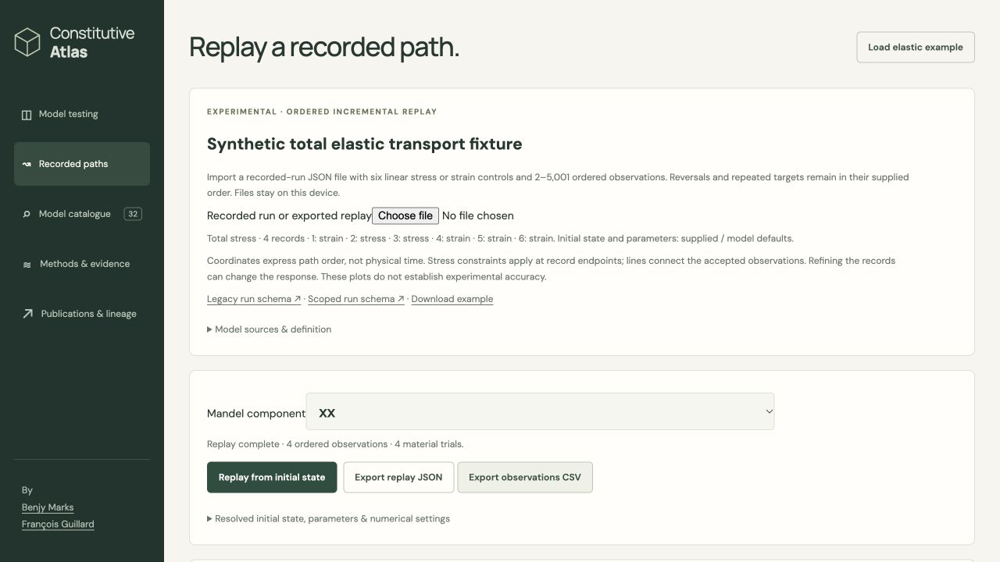

# Recorded scope browser integration

The recorded-path view now accepts explicit scoped0.2 requests and matching
exports through the [pure document boundary](../recorded-scope-documents-v1/README.md).
It passes the trusted compiled catalogue to a shared worker dispatcher, selects
the new scoped endpoints, and verifies returned scope/model/catalogue/settings
and retained prefixes before enabling exports. Legacy requests retain their
legacy effective API and export versions. There is no scoped-to-legacy fallback.

The summary, chart heading, axis/title and accessible description identify the
stress scope. Recorded mechanics supplies no pore reconstruction: scoped CSV
uses the correct component names and explicit scope with unavailable/blank pore
values. JSON retains full state. Both request schemas are linked. A replacement
import clears the prior model, summary, sources, results and plots; generation
cancellation guards still prevent late reads/responses from replacing current
work. A browser-observed stale summary was fixed and regression-tested.
All new module dependencies are included in static packaging. The laboratory
view still uses its earlier effective-only contract.

## Prospective qualification

[freeze.json](freeze.json) precedes compilation and observations. It fixes the
existing private10-record transport catalogue, three scoped requests, nine legacy
zero-path checks, response/status/counter comparisons, labels, documents,
failure retention, cancellation and missing-export behavior. The fixture is the
nine unchanged public records plus synthetic total elasticity; it is not a new
atlas model or an ingestion path. Source lowering and analytical native references
remain those of `recorded-scope-native-v1`. No new native material runs occur.

One explicit target was compiled serially with `--parallel 1`.
[The initial build failure](build.json) is retained: sandbox permission denied an
Emscripten system cache lock during linking. [The operational resume](resume-note.json)
continued the identical target/flags with cache access; [linking passed](build-resume.json).
This is one compilation and a resumed link, rather than two alternative builds.
No source, tolerance or acceptance rule was changed to obtain a numerical pass.
Toolchain is Emscripten6.0.8; generated catalogue, engine hashes and source pins
are retained. The binary remains a local artifact, not a published engine.

[Wasm responses](responses.json) pass strict consumer validation and the frozen
native comparisons: three scoped runs (effective mixed reversal, budget-limited
failure, synthetic total mixed reversal), plus all nine legacy zero paths.
Structures, status and integer counters are exact; other finite numerical values
use the frozen relative1e-9 comparison (integer-valued numbers also match exactly).
The total analytical reference is inherited via the exact saved native response;
this is backend/consumer qualification, not independent Tresca verification.

Static packaging initially rejected the stale five-model default build folder;
that failed receipt is retained. Selecting the existing matching nine-model
artifact explicitly produced a normal628-experiment public package, with all
new modules copied exactly. No package checks were bypassed. An isolated copy
then replaced only the engine/catalogue with the private10-record fixture.
The three request JSON files were added for local file-picker tests. The
case-specific HTML copies change only the download-example hyperlink; the actual
Load elastic example button still fetches the standard legacy example. App,
chart, view and worker modules are the real packaged consumers.

## Actual page and saved exports

At `http://127.0.0.1:8950/constitutive-atlas/total-mixed.html#recorded`, the actual
file picker imported all three scoped requests. Both successful requests reported
four observations/four material trials. The budget-limited effective request
reported record2 failure and retained two committed observations. The synthetic
total summary, heading, SVG description and chart title say total stress;
effective requests say effective stress. The standard legacy example completed
five observations/six trials, including recovery after a rejected scope import.
Two legacy-example replays occurred during the browser interaction. Initial app
laboratory runs on page load are outside the recorded study, not scientific evidence.

[Total JSON](browser-total.json), [total CSV](browser-total.csv),
[effective JSON](browser-effective.json), [failed-prefix JSON](browser-failure.json)
and [legacy JSON](browser-legacy.json) were downloaded using the real export
buttons. Scoped JSON results match the frozen responses; the total CSV matches
the document module exactly. The legacy envelope remains0.1. A deliberately
wrong request scope was rejected with replay/exports disabled; after the reset
correction the prior summary no longer remained. Missing export/no fallback and
pre-worker rejection are covered deterministically, not by switching live engines.



The total screenshot precedes the import-reset-only correction. Final consumer
source pins identify that correction; the actual rejection/reset and legacy
recovery were then rechecked. Compiled source/header pins did not change.
The final public package was refreshed with that exact view source; no rebuild
or repeated numerical campaign was required.

## Verification and stopping point

```sh
python3 -B -m unittest tests.test_recorded_scope_view tests.test_recorded_import_cancellation tests.test_web_recorded tests.test_recorded_document tests.test_recorded_scope_execution tests.test_recorded_scope tests.test_evidence_archives tests.test_recorded_scope_view_evidence -q
```

The saved-only assessor below checks numerical/identity/export evidence without
an engine. Focused tests cover the actual view/worker modules with saved responses,
legacy behavior, import/reset/cancellation, CSV/JSON and no fallback. Source snapshots
and additive archive maps preserve affected historical bytes; original receipts
remain unchanged. A passing consumer gate does not admit a model scientifically.

Stop this delivery here. Next complete the laboratory consumer scope contract
(labels, protocol semantics, nullable pore plots, examples, documents and API
routing), then qualify its Wasm/browser gate. Production total-profile validation
and the existing Tresca transcription remain disabled/separate until the complete
interface and source/reference/backend gates pass. Nine public models remain;
no push, deployment, scientific status change or reviewer assignment.
